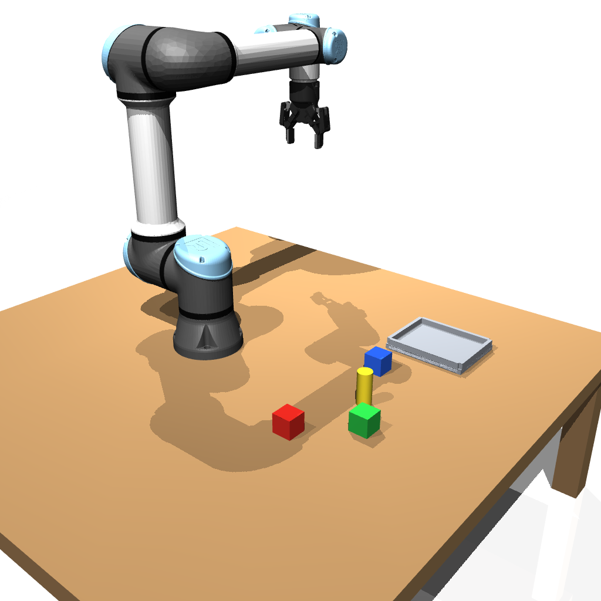
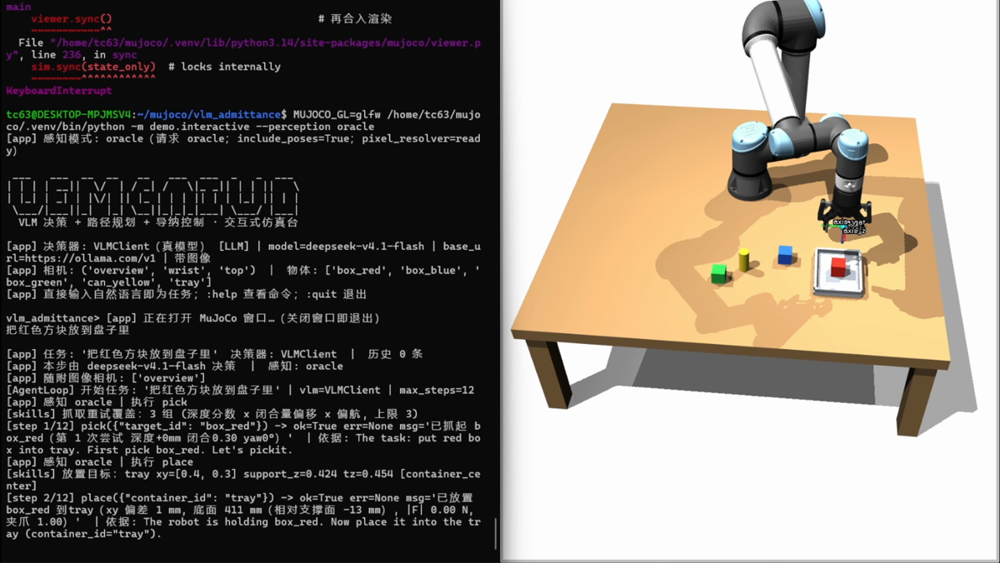
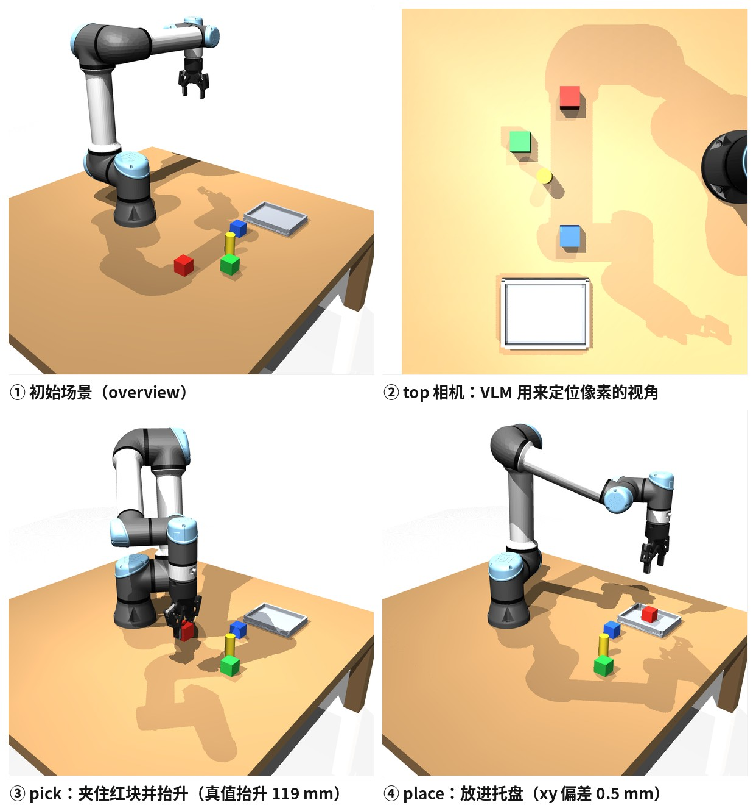
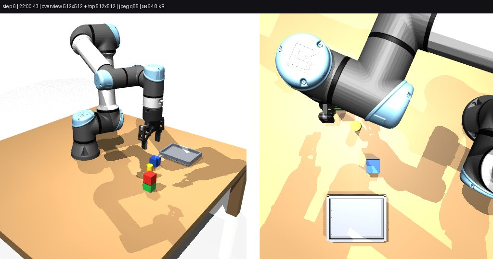
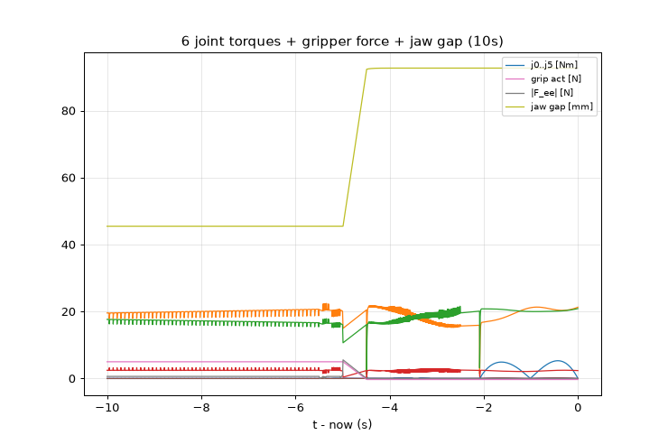

<div align="center">

# VLM Admittance

**多模态大模型决策 + RRT-Connect 规划 + 六维导纳控制的 MuJoCo 机械臂抓取框架**

UR5e + Robotiq 2F85 · 3 相机离屏渲染 · 任意 OpenAI 兼容多模态端点 · 不需要训练 VLA


[演示](#演示) · [安装](#安装) · [使用方法](#使用方法) · [结果](#结果) · [已知问题](#已知问题)

</div>

---

MuJoCo 里的 UR5e + Robotiq 2F85 抓取框架。上层用支持图片输入的多模态大模型做任务级决策
（抓哪个、放到哪、多柔、失败了怎么改），底层是自己写的经典控制：DLS IK、笛卡尔 min-jerk
轨迹、六维导纳外环、RRT-Connect 规划。所以不需要数据集，也不需要训练 VLA —— 换成任意
OpenAI 兼容的多模态端点就能跑，没有 key 时用 `MockVLM` 走同一条代码路径。

开发环境：Python 3.14 + MuJoCo 3.12 + numpy/scipy/pillow，只有这几个依赖。
参考实现是 [momo-qxc/VLM_Grasp_Bio](https://github.com/momo-qxc/VLM_Grasp_Bio)
（MuJoCo + UR5e + VLM + SAM + GraspNet + RRT），本项目的取舍见下文对照。



## 演示

[](docs/media/vla_arm_demo.mp4)

左边是命令台（`./run.sh`，敲一句中文就是任务），右边是 MuJoCo 窗口，跑任务时窗口不卡。
完整视频 54 s / 1920×1080：[docs/media/vla_arm_demo.mp4](docs/media/vla_arm_demo.mp4)（36 MB）。

视频里的一帧，能看到命令台的决策日志和仿真侧的动作：



一次 pick → place 的四个瞬间，图是这套代码跑出来直接存的：



## 仓库内容

- **决策** `agent/`：每步把 2~3 张相机图和场景 JSON（物体 id / 颜色 / 类别，不含真值位姿）
  拼成 messages，用 function calling 拿回 `SkillCall`；`loop.py` 执行技能并做抓取验证，
  `taskplan.py` 把一句自然语言拆成子目标、逐个动作、逐个复核。真端点走 `VLMClient`，
  离线走 `MockVLM`。
- **技能** `skills/library.py`：把 `SkillCall` 变成确定性动作序列——规划接近位、守卫式下压、
  按物体宽度反算闭合量、合爪看门狗、抬升、放置、失败重试与脱困。
- **控制** `control/`：`kinematics`（DLS IK + 零空间）、`trajectory`（min-jerk + slerp）、
  `admittance`（6 维 M/D/K 外环）、`motion`（执行 + 力看门狗 + 任务空间积分外环）。
- **规划** `planning/`：自研 RRT-Connect（含 shortcut / densify），碰撞检测用私有 `MjData`，
  不动 `env.data`。
- **仿真** `sim/`：`MjSpec.attach` 拼出 UR5e + 2F85 + 桌面 + 5 个物体 + 3 个相机（overview /
  wrist / top），RGB 与深度离屏渲染、接触力查询。
- **契约** `core/` 与 [INTERFACES.md](INTERFACES.md)：类型、配置、各模块 Protocol。

## 架构

```
慢环 0.5~2 Hz（事件触发）— agent/
  render(overview/wrist/top) + SceneState
      → build_messages（图像 + 场景 JSON + 历史）
      → VLM（OpenAI 兼容, function calling）/ MockVLM
      → parse_skill_call → validate_skill_call
      → SkillCall{skill, args, compliance}
                     ↓ skills/
快环 500 Hz（每步 mj_step）
  skills: pick / place / push / home / move_to / set_compliance …
    规划: RRT-Connect + CollisionChecker（私有 MjData）
    轨迹: CartesianTrajectory（min-jerk + slerp）
    导纳: M·ẍ + D·ẋ + K·(x − x_ref) = −f_ext → Δx
    执行: IK（DLS + 零空间）→ 关节目标 → MuJoCo 位置伺服
    力源: contact_force_on_ee()（仿真里不用力传感器）
```

大模型每步只拿到场景 JSON（不含物体真值位姿）和相机图；「轻一点」这类词会被模型翻译成
导纳参数（K/D/axes/force_limit），经 `skills` 兜底后作用在快环上。



交互式运行时还有一个实时面板（6 关节力矩 + 夹爪力 + 指间距）。面板是纯文件产出，
headless 下同样出图：



## 安装

```bash
git clone https://github.com/TC635807/vlm-admittance.git
cd vlm-admittance
python3 -m venv .venv && source .venv/bin/activate
pip install -r requirements.txt

export MUJOCO_GL=glfw        # 离屏渲染；本机 EGL 不可用时必须
```

Windows 上是 WSL + WSLg 跑通的，X socket 在 `/mnt/wslg/.X11-unix/X0`。自动化、自测、CI
一律加 `--headless`，不加会真的在桌面上弹 MuJoCo 窗口。

## 使用方法

最省事的是 `run.sh`（自动设好 `MUJOCO_GL` / `DISPLAY` / `PYTHONPATH` / 解释器）：

```bash
./run.sh                    # 交互式：MuJoCo 窗口 + 命令台
./run.sh headless           # 无窗口，面板照常出图
./run.sh daily              # 日常物品场景（水瓶 / 眼镜盒）
./run.sh task "把红色方块放到盘子里，绿色方块放到红方块上"
./run.sh panels             # 打开画面 / 力矩曲线面板
./run.sh doctor             # 环境与配置体检
```

等价原始命令：

```bash
MUJOCO_GL=glfw python -m demo.interactive              # 窗口 + 命令台
MUJOCO_GL=glfw python -m demo.interactive --vlm api    # 用真实大模型决策
MUJOCO_GL=glfw python -m demo.interactive --headless   # 无窗口

MUJOCO_GL=glfw python -m tests.run_acceptance          # 全链路验收
MUJOCO_GL=glfw python -m demo.scripted_pick_place --target box_red --container tray

AI_API_URL=... AI_API_KEY=... AI_MODEL=... python tools/vlm_probe.py   # 端点能力探针
```

凭据只从环境变量读，不落盘；也认 `VLM_*` / `OPENAI_*` 别名和本地 `config.local.json`
（已 gitignore，模板见 [config.local.json.example](config.local.json.example)）。

命令台里直接输中文/英文就是任务，`:` 开头的是单条命令：

| 命令 | 作用 |
|---|---|
| `:task <文本>` | 显式指定任务 |
| `:pick <id>` / `:place <id>` | 抓取 / 放置（例 `:pick box_red`） |
| `:goto x y z` | 规划后移动到坐标 |
| `:push <id> dx dy dz [dist]` | 推动物体 |
| `:gripper open\|close\|<0~1>` | 夹爪控制 |
| `:compliance stiff\|soft\|z_only [k_scale]` | 切换导纳档位 |
| `:home` / `:reset` | 回初始位姿 / 重置场景 |
| `:objects` / `:state` / `:shot [camera]` | 列物体 / 打印状态 / 存一张渲染图 |
| `:vlm mock\|api` | 热切换决策器 |
| `:help` / `:quit` | 帮助 / 退出（关窗口同样退出） |

实现上主线程跑 `viewer.sync()`，工作线程跑命令台和技能；`env.step` 与 `env.render`
共用同一把 RLock，所以在跑任务时窗口仍然流畅。

## 结果

`tests/run_acceptance`（2026-10-12 实跑）：**9/10 通过**，唯一失败是
`tests/test_target_overlay.py::test_injected_force_pure_compliance` 的导纳让位方向
（断言 `0.32 not less than 0.0`），属已知未修项。

| 验收项 | 关键指标 |
|---|---|
| core | 契约导入、资产存在 |
| sim.smoke | `nq/nv/nu` 与契约一致；3 相机 512×512 RGB + 深度；静止力 0.000 N |
| control.smoke | 44 用例；IK 往返 0.38 mm / 4.9e-4 rad；`move_to_pose` 终态 0.98 mm；导纳阶跃稳态 = −f/k、不发散 |
| planning.smoke | 5 用例；`plan_pose` 误差 0.0000 m；绕障 0.12 s、挡板接触 0 |
| agent.smoke | 239 用例；`MockVLM` 决策确定性；非法调用被拒 |
| e2e_scripted | `box_red` 抓起抬升 119.3 mm（峰值力 1.46 N）→ 放进托盘，落点偏差 0.5 mm |
| interactive_selftest | `demo.interactive --headless --self-test`：真实技能库 + 子目标编排 + 独立复核 |
| interactive_flows | 17 用例：意图路由、hold 不变量、强制恢复、pick 子目标复核 |
| target_overlay | FAIL：导纳让位方向（既有缺陷） |
| place_semantics | 抓放语义 / 叠放 / 容器判据 |

其余单测：`sim.test_env` 14、`tests.test_grasp_height` 9、`tests.test_panels` 12、
`tests.test_subgoal_loop` 6、`tests.test_isolation_no_truth` 5（这个用例里 `object_pose`
一类的真值接口直接抛异常，纯视觉闭环仍要跑通）等。抓放覆盖 `box_red / box_blue / box_green`；
`can_yellow` 见已知问题。

真实端点实测（`AI_API_URL=https://ollama.com/v1` + `AI_MODEL=deepseek-v4.1-flash`，
`tools/vlm_probe.py` 文本 / 图片 / function calling 三项都通过）：

| 指令 | 模型决策序列 | 结果 |
|---|---|---|
| 把红色方块放进托盘 | `pick(box_red)` → `place(tray)` → `stop` | 成功，11.9 s |
| 把绿色方块放进托盘 | `pick(box_green)` → `place(tray)` → `stop` | 成功，9.1 s |
| 把蓝色方块轻放进托盘，别压坏 | `set_compliance(soft)` → `pick(box_blue)` → `place(tray)` → `stop` | 成功，10.6 s |

## 与 VLM_Grasp_Bio 的对照

| 能力 | VLM_Grasp_Bio | 本项目 |
|---|---|---|
| 机器人 / 仿真 | MuJoCo + UR5e | MuJoCo + UR5e + Robotiq 2F85（Menagerie 模型，`MjSpec.attach` 组合） |
| 语言解析 | Qwen-VL-Max + DeepSeek 润色 | 任意 OpenAI 兼容多模态端点 + `MockVLM` 离线回退 |
| 视觉 | 多相机 + SAM 分割 + 深度 | 3 相机离屏渲染（可扩 depth→点云）；不做分割，物体清单用仿真给的 id/颜色 |
| 抓取位姿 | GraspNet 生成 | 解析式：按几何和抓取宽度反算闭合量，多次 re-grasp |
| 规划 | 改进 RRT + 在线避障 | RRT-Connect（自研，含 shortcut / densify） |
| 柔顺控制 | — | 6 维导纳外环 + 技能级柔顺档 |
| 工程形态 | 单仓大脚本 + GUI | 分层模块 + 冻结接口 + 每模块 smoke + 全链路验收 |

没引入 GraspNet / SAM（依赖太重），抓取姿态改用几何解析；没做 Qt GUI，命令台就在终端里。

## 几点经验

- **复核前"让开视线"会把刚抓起的物体丢掉。** 原来每个子目标复核前都调 `skills.home`，
  带载时规划失败会走 `env.home()` 瞬移，而瞬移还顺手张开了夹爪 —— 方块落回原位，复核判
  `subject_still_present`，`g1:pick` 三次尝试全废，技能层却报"已抓起"。现在 pick 子目标或
  仍持物时不归位，带载禁止瞬移兜底（返回 `home_blocked`），带载归位改走关节路径。
- **抓取成功不能用代理值判。** 夹爪开合比例换算出来的"指间距"和真实指垫间距差 7~10 mm，
  "被挡住"和"没合到位"分不开；更要命的是抬升 `move_to_pose` 的返回值曾经被完全忽略，
  实测抬升 46 N 中止、方块只动 1 mm 仍报成功。现在要求抬升 ok，且夹爪接触的物体确实离地。
- **单相机验证两个方向都会错。** 腕部相机只要停在物体上方就能看到上万像素（近似恒真的假阳性），
  top 前后对比又对"举高但仍可见"漏判（蓝块真抓起后 top 面积 818→827）。现在主判据是 top 的
  `check_gone`，配物理随动证据兜底，再加"夹的必须是目标物 / 腕部看不到目标色不放行"的反闸。
- **`size=(0.02, 0.02, 0.02)` 是半尺寸**，也就是 40 mm 方块。按 20 mm 算闭合量会把方块捏死，
  抬升直接超力限。
- UR5e 位置伺服没有重力补偿：HOME 静沉约 11 mm、任意关节角稳态静差约 14 mm，纯 IK→ctrl
  到不了 5 mm，必须加任务空间积分外环 + 速度前馈 + 收尾伺服。抓取下降段只用 z 向柔顺，
  否则接触反力把末端推横、指垫夹偏；接触失败后先松爪再撤退，闭合着抬升会把物体和托盘一起拖走。
- 交互式下取图必须和 `viewer.sync()` 同锁：`Renderer` 会读 `data`，和主线程并发是数据竞争
  （实测 SIGABRT）。另外 `MjSpec.from_string` + attach 加物体给名字加了 `/` 前缀，
  `mj_name2id` 直接返回 −1，改用 MjSpec API 直接加。

## 目录

```
vlm-admittance/
├── run.sh                  # demo / headless / task / panels / doctor
├── core/                   # 冻结契约：types、config、Protocol
├── sim/                    # 场景、渲染、相机标定（vision）、几何判据（perception）
├── control/                # IK、轨迹、导纳、执行器
├── planning/               # 碰撞检测、RRT-Connect、关节规划
├── agent/                  # 状态序列化、TOOLS schema、VLMClient/MockVLM、AgentLoop、子目标编排
├── skills/                 # 技能库：SkillCall → 确定性动作序列
├── demo/                   # interactive（窗口+命令台）、run_demo、scripted_pick_place、panels
├── tests/                  # run_acceptance + 各专项回归
├── tools/                  # vlm_probe、vision_accuracy、live_vla_baseline
├── assets/                 # Menagerie 的 ur5e 与 robotiq_2f85（BSD-3-Clause）
├── docs/                   # 上面的图片和演示视频
├── outputs/                # 运行产物（面板 / 验收日志），已 gitignore
└── INTERFACES.md           # 模块契约（冻结版）
```

## 文档

- [INTERFACES.md](INTERFACES.md)：模块契约，并行开发和集成的依据
- `outputs/`（已 gitignore）：面板 PNG、验收日志、抓取失败诊断与修复报告

## 已知问题

- `test_target_overlay` 的导纳让位方向用例失败（验收里唯一的红）：外力 +z 时参考位移应为负，
  实测 +0.32，符号没修。
- 细高圆柱 `can_yellow` 抓取不稳。2F85 指垫对 30 mm 圆柱的接触窗口窄，成败对末端下沉量
  （位置伺服无重力补偿，随位形漂 ~1 cm）敏感。
- `--with-barrier` 场景下的抓放不可靠：规划只对"臂 + 夹爪"做碰撞检测，不建模被夹着的物体。
- 接触力尺度大。UR5e 位置执行器刚性压入时末端力能到 1e3 N，`force_limit`（8~20 N）很容易触发，
  所以接近段都用柔顺或慢速轨迹绕开。
- `env.home()` 是个裸瞬移，低层直接调用它不做"是否持物"判断，持物时会掉件；流水线里已经
  全部改成带载禁瞬移。
- 感知给的 z 不稳。overview 第二像素在某些实现里没有形状守门，遮挡下颜色精修会漂（实测一次
  偏 33 px），而 `residual < 15 mm` 不是有效的可信度判据（接受带对应 ±100 mm 的深度误差）。
- 夹爪闭合量按物体宽度线性估算（ratio=1→93 mm，ratio=0→8.4 mm），没做接触力闭环。
- 演示视频 36 MB 直接入库，clone 会慢；嫌大的话可以换成 Release 附件或 user-attachments 链接。

## 致谢

- [momo-qxc/VLM_Grasp_Bio](https://github.com/momo-qxc/VLM_Grasp_Bio)：本项目的参考实现
- [MuJoCo](https://github.com/google-deepmind/mujoco) 与
  [MuJoCo Menagerie](https://github.com/google-deepmind/mujoco_menagerie)：物理引擎和
  UR5e / Robotiq 2F85 模型

## License

代码暂时没有附许可证文件；`assets/` 下的两个模型来自 MuJoCo Menagerie，遵循 BSD-3-Clause
（各目录下有 `LICENSE`）。
